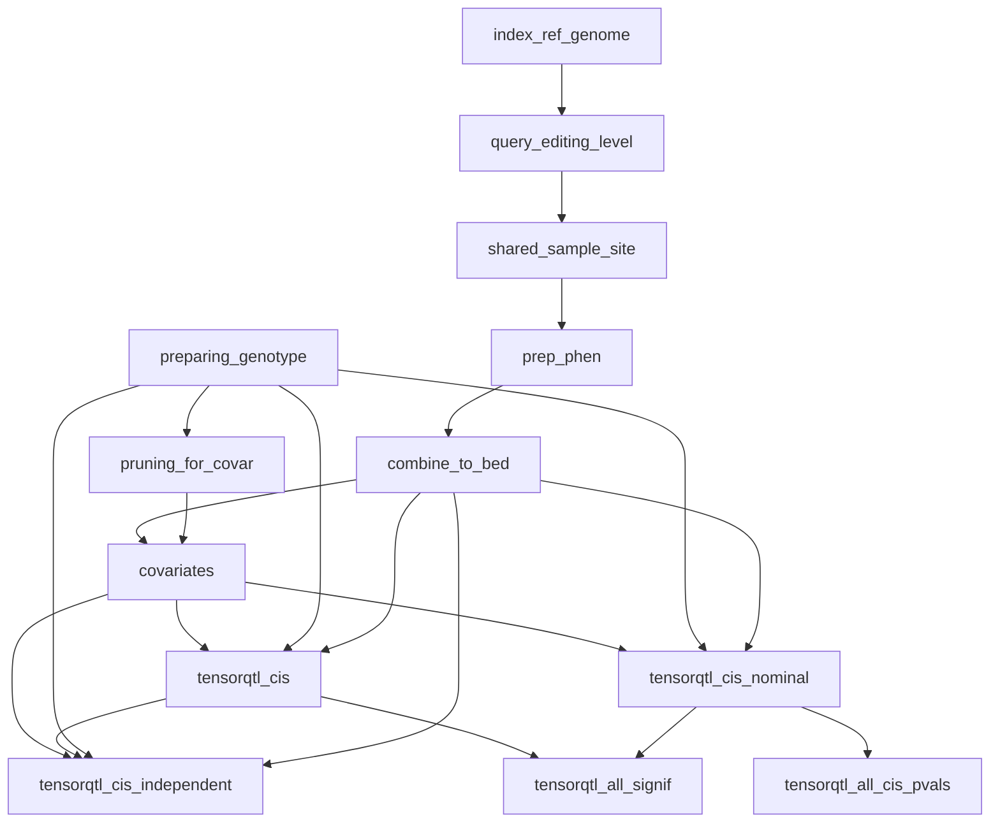
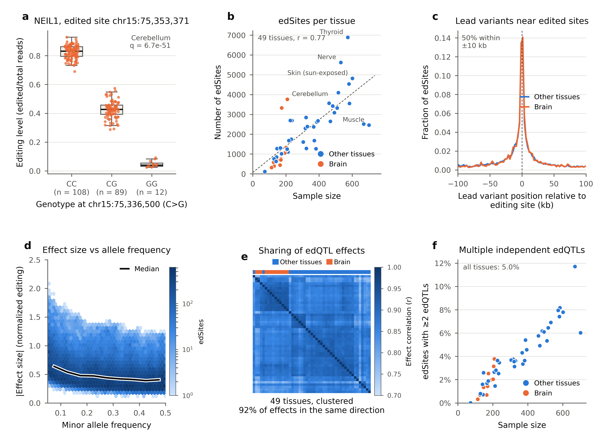

# RNA editing QTL mapping pipeline

<div align="justify">

A Snakemake pipeline for mapping cis RNA editing QTLs (edQTLs) in each tissue. It quantifies A-to-I RNA editing at known sites using RNA-seq BAM files, builds and normalizes a tissue-specific editing-ratio matrix, and maps cis-edQTLs with [tensorQTL](https://github.com/broadinstitute/tensorqtl), using genotype PCs, phenotype (editing ratio) PCs, sex, and age as covariates.

The pipeline is based on Li et al. (2022), “RNA editing underlies genetic risk of common inflammatory diseases,” and is also implemented in [Pantry](https://github.com/PejLab/Pantry) (PAN-TRanscriptomic phenotYping), a framework for multimodal transcriptomic phenotyping and QTL mapping.

Use this repository to run the RNA editing pipeline independently. To analyze RNA editing alongside six additional RNA phenotypes, use Pantry.

It was written for GTEx v8 (BAM files aligned with STAR to the hg38 reference genome, and WGS genotypes), but should work for any cohort with BAM files, a VCF, and sample annotation.

## Workflow

Steps of the Snakemake workflow and their dependencies:



With `expression_covariate: true`, an extra step, `regress_expression`, runs after `combine_to_bed`, and the covariates and tensorQTL steps use its output (see [Configuration](#configuration)).

## Installation

```sh
mamba env create -f envs/environment.yml
mamba activate rna_editing_env
```

The environment installs a CPU build of PyTorch. tensorQTL runs on CPU, but a CUDA GPU is much faster, mainly for the permutation step. To use a GPU, set `tensorqtl_env` in the config to an environment with a CUDA build of PyTorch (check with `python -c "import torch; print(torch.cuda.is_available())"`); with `--use-conda`, as in the SLURM profile, Snakemake runs the tensorQTL steps in that environment and the other steps in `conda_env`.

## Input

Paths are set in `config/config.yaml`. Input data is not included in the repository.

- RNA-seq BAMs, one per sample, in `data/bam/` (named `{sample_id}.{bam_extension}`)
- Genotypes as a VCF, with subject IDs as sample names
- Reference genome FASTA (the same build used for alignment)
- A BED file of known editing sites (a filtered hg38 list is included in `src/`; full hg38 and hg19 lists are available from [REDIportal](https://rediportal.cloud.ba.infn.it/atlas/index.html))
- A sample annotation file (`sample_id`, `subject_id`, `tissue_cln`)
- A subject covariates file (`subject_id`, `sex`, `age`)

The annotation and covariates files in `src/` are small examples of the format.

## Configuration

All settings are in `config/config.yaml`. Mapping and base quality cutoffs are at the top of `scripts/query_editing_level.pl`.

There are two normalization options (`normalization`):

- `quantile_int` (default): quantile normalization of samples, then a rank-based inverse normal transform of each site across samples, as in Pantry and the GTEx eQTL pipeline. Every site ends up normally distributed, so a few extreme samples can't drive an association.
- `zscore_qqnorm`: z-score of each site, then quantile normalization of each sample to a normal distribution, as in LeafCutter and Li et al. (2022).

To regress host-gene expression out of editing levels before mapping, set `expression_covariate: true` (default `false`). This needs two files, set in the config: a gene TPM table (`gene_tpm`, e.g. the GTEx v8 `gene_tpm.gct.gz`) and the site-to-gene table (`gene_annotation`, `src/edit_site_gene_annotation.tsv.gz` in this repository). The [Results](#results) below were produced with it on.

## Running

Run from the repository root. The recommended way is on a SLURM cluster with the profile in `profiles/slurm/`, which runs every step as its own job and sends tensorQTL to a GPU partition. Install the executor plugin (`mamba install -c bioconda snakemake-executor-plugin-slurm`), fill in your partitions and account in `profiles/slurm/config.yaml` and `profiles/slurm/run_pipeline.sbatch`, then:

```sh
snakemake --profile profiles/slurm -n         # dry run
sbatch profiles/slurm/run_pipeline.sbatch     # run
```

The profile also sets how many jobs and GPU jobs run at once. A full GTEx run (49 tissues, about 15,000 samples) takes about 15 hours this way.

To run on a single machine instead:

```sh
snakemake -j 16 -n                                  # dry run
snakemake -j 16 --printshellcmds --latency-wait 30  # run
```

Add `--resources tensorqtl_slots=1` to run one tensorQTL job at a time on a single GPU.

## Output

Results go to `results/{tissue}/`:

- `{tissue}.cis_edQTLs.txt.gz`: top variant per site from permutations, with q-values
- `{tissue}.cis_independent_edQTLs.txt.gz`: conditionally independent edQTLs
- `{tissue}.cis_edqtl_signif.txt.gz`: all significant site-variant pairs
- `{tissue}.cis_edqtl_all_pvals.txt.gz`: nominal p-values for all tested pairs
- `nominal/`: full nominal statistics, one parquet file per chromosome

## Results

cis-edQTLs across 49 GTEx tissues (15,172 samples). Editing levels were normalized with `quantile_int` (quantile normalization of samples, then a rank-based inverse normal transform of each editing site), the expression of each site's host gene(s) was regressed out, and variants within ±100 kb of each site were tested, as in Li et al. (2022). In total, 32,308 editing sites have an edQTL at FDR ≤ 5% in at least one tissue (104,143 across tissues).



- **a**, Example edQTL: editing level at a site in *NEIL1* by genotype of the lead variant in brain cerebellum.
- **b**, edSites (sites with an edQTL) per tissue against sample size (r = 0.77).
- **c**, Position of the lead variant relative to the edited site; half lie within 10 kb.
- **d**, Effect size against minor allele frequency for all edSites.
- **e**, Correlation of edQTL effects between tissues; 92% of effects have the same direction, and brain tissues cluster together.
- **f**, Fraction of edSites with more than one independent edQTL, against sample size (5.0% overall).

## Credits and references

This pipeline builds on code and methods from:

- Qin Li, Michael J. Gloudemans, Jonathan M. Geisinger, Boming Fan, François Aguet, Tao Sun, Gokul Ramaswami, Yang I. Li, Jin-Biao Ma, Jonathan K. Pritchard, Stephen B. Montgomery, Jin Billy Li. RNA editing underlies genetic risk of common inflammatory diseases. *Nature* 608, 569–577 (2022). https://doi.org/10.1038/s41586-022-05052-x
- Daniel Munro, Nava Ehsan, Seyed Mehdi Esmaeili-Fard, Alexander Gusev, Abraham A. Palmer, Pejman Mohammadi. Multimodal analysis of RNA sequencing data powers discovery of complex trait genetics. *Nature Communications* 15, 10387 (2024). https://doi.org/10.1038/s41467-024-54840-8

## Author

Mehdi Esmaeili-Fard (mehdi.esmaeilifard@gmail.com).  
Completion date: May 2025.

## License

MIT, see [LICENSE](LICENSE).

</div>
